

  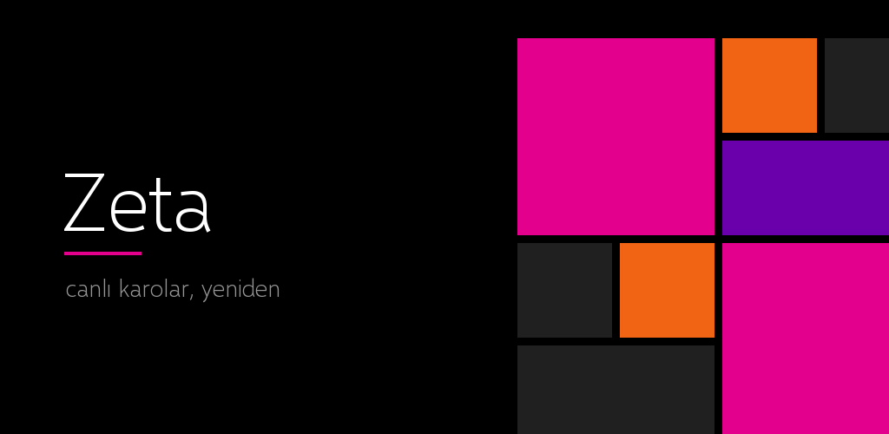

<strong>Canlı karolar, yeniden.</strong> 
Telefon, tablet ve televizyon için sıfırdan yazılmış bir arayüz paketi: canlı karolar, hub'lar, turnike animasyonları ve ince, büyük yazılar. Başlangıç ekranından mesajlara, müzikten televizyona kadar hepsi aynı dilde; telefon bağlantısıyla cihazların birbirinden haberi olur.

  <a href="https://serkantkn.github.io/Zeta/">tanıtım sitesi</a> · <a href="#english">English below</a>

  
  
  
  
  
  

  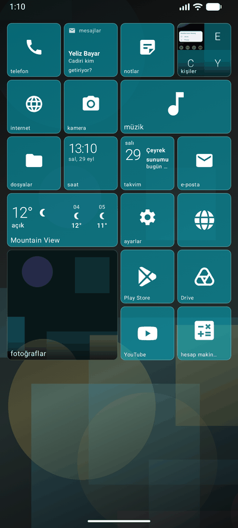
  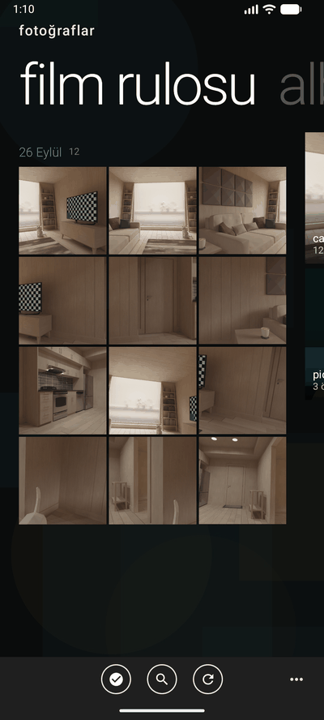
  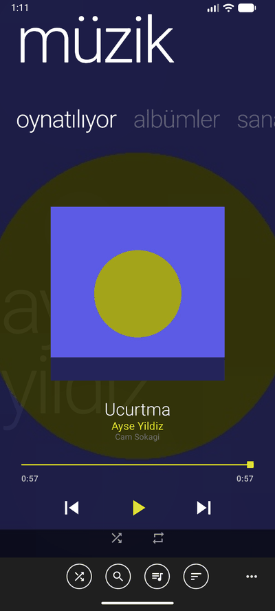
  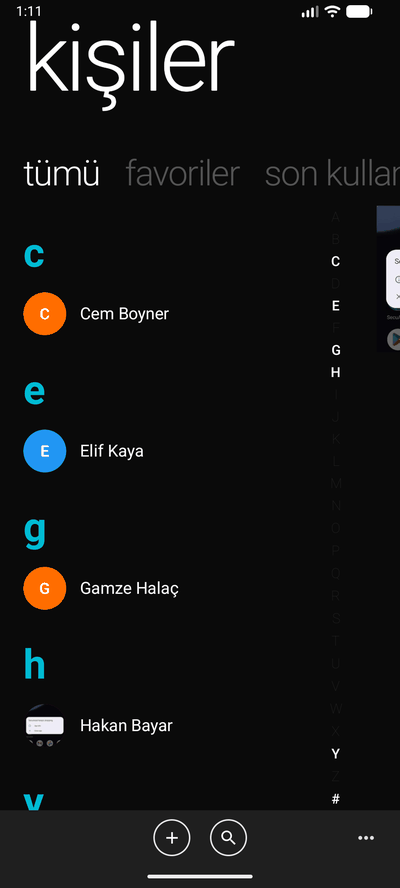
  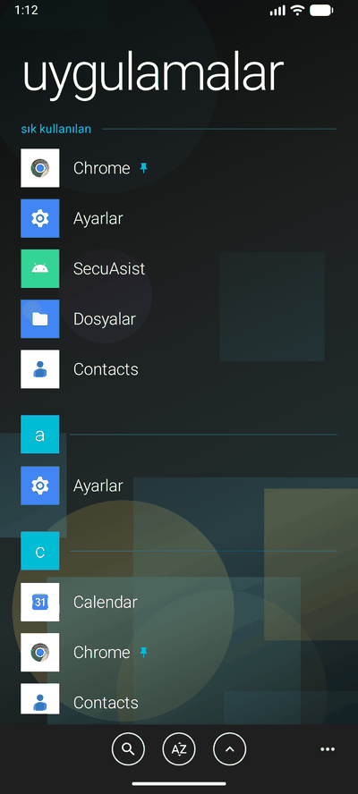

---

## Neden

Canlı karolu telefonlar gitti; onları seven bir avuç insan kaldı. Zeta o dili taklit etmiyor,
**yeniden yapıyor**: karoların dönüşünden bir hub'a girerken karoların turnike gibi savrulmasına,
klasör adının listeden kalkıp sayfanın başlığı olmasına kadar. Bugünün Android'inde, bugünün
telefonlarında çalışıyor — ve hiçbir şeyi hiçbir yere göndermiyor.

  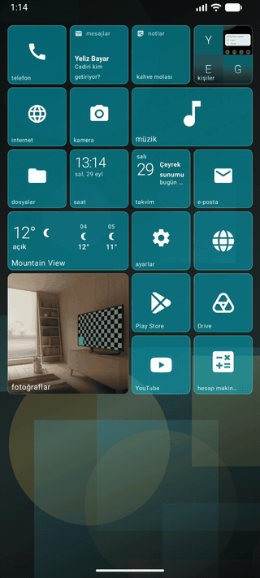
  &nbsp;&nbsp;
  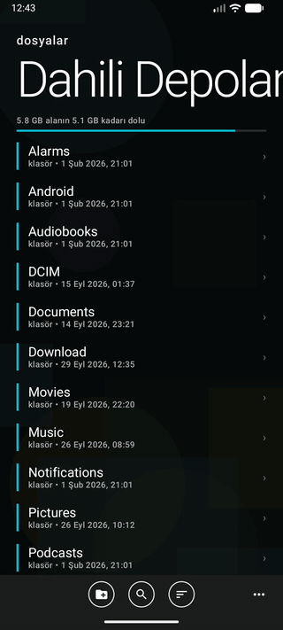

Solda: bir hub'a giriş ve çıkış. Sağda: dosyalar hub'ında klasöre giriş ve çıkış.

## Başlangıç ekranı

- **Canlı karolar.** Saat, takvim, mesajlar, kişiler, hava durumu, haberler ve müzik karoları kendiliğinden döner;
  kaydırma ya da çevirme hareketi seçilir, karo başına da ayarlanabilir.
- **Dört boyut.** Küçük, orta, geniş, büyük. Her canlı karo her boyut için ayrı düzenlenmiş; bildirim sayısı
  simgenin hemen yanında. Sürükle, sırala, üst üste bırakıp klasör yap.
- **Buzlu karolar** *(Pro)*. Saydam karoların arkasındaki duvar kağıdı buzlu cam gibi bulanıklaşabilir; ne kadar,
  ayarlardan.
- **Widget'lar.** Pil, fener, zamanlayıcı, ses modu ve arama; *(Pro)* dünya saati, geri sayım, notlardan bir
  yapılacaklar listesi ve günlük adım. Mozaik'te ve Panorama'da karo, Aura'da karolar sayfasında durur; dört boyutun
  her biri için ayrı düzenlenmiş; sayaçlar Aura'nın saati gibi hane hane döner, pil widget'ı geniş
  boyutta iki, büyükte dört cihazı (telefon ve bağlı kulaklık, saat, klavye…) adlarıyla gösterir. Müzik karosu çalan uygulamayı (Spotify da olur) karodan yönetir, takvimin büyük
  karosu ayı gösterir.
- **Her şey sabitlenir.** Uygulama, kişi, konuşma, albüm, plak, not, web sayfası.
- **Karo başına kişiselleştirme** *(Pro)*. Renk, ad, simge (Mozaik glifleri, ikon paketi ya da kendi resmin),
  simge boyutu, karoyu dolduran resim, animasyon, bildirim, şeffaflık ve yazı rengi — hepsi tek karo için,
  tek dokunuşla sıfırlanabilir.
- **Hub yerine uygulama.** İstersen "internet" karosu Chrome'u açsın; her hub istediğin uygulamaya yönlendirilebilir.
- **Üç düzen.** Mozaik (canlı karolar), Aura (dev yazılı hub listesi) ya da tablette Panorama (yatay pano).
- **Çalışan hub'lar.** Home tuşuyla çıktığın hub arka planda kalır; panonun altında, Home'a çift basınca
  açılan görev değiştiricide ya da iki parmakla yukarı çekince bölünen ekranda geri gelir.

  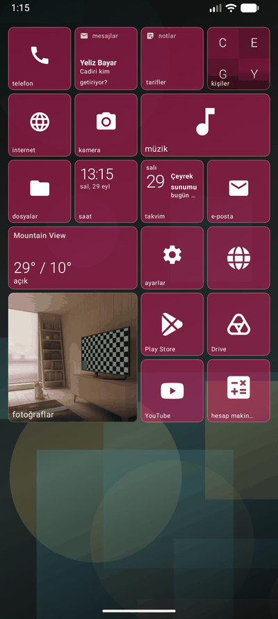
  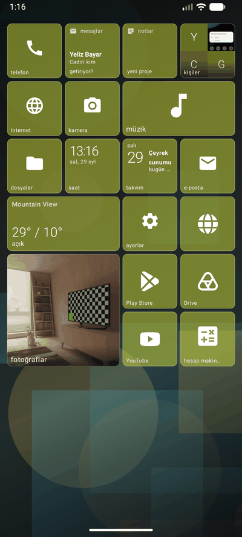
  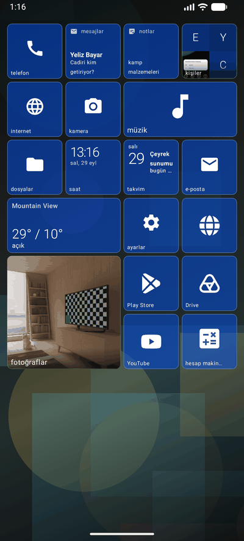
  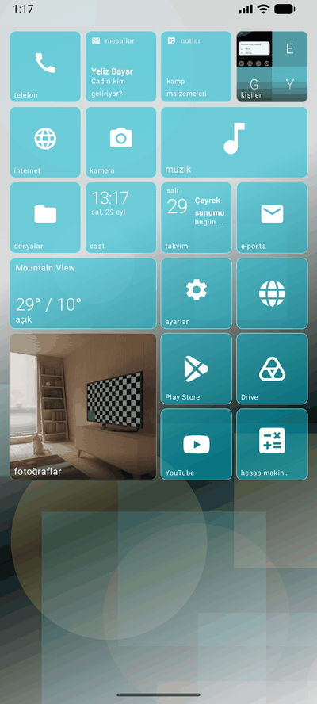
  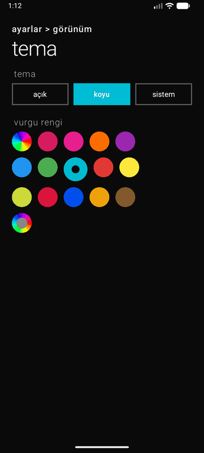

Varsayılan renk tasarıma göre (Mozaik mavi, Aura turuncu, Panorama kırmızı, Konsol yeşil), Aura'nın arkasında magentadan turuncuya bir ışıltı; on dört vurgu rengi, özel renk, koyu ve açık tema, saydamlık, köşe biçimi, karo aralığı.

## Aura düzeni

Başlangıç ekranının ikinci yüzü, kelimelerden bir hub listesi:

- **Kelimelerle hub'lar.** Saat, tarih ve hava durumunun altında hub adları ince, büyük yazıyla; altlarında son mesaj,
  çalan parça, sıradaki etkinlik gibi canlı satırlar.
- **Uçan başlık.** Telefon, kişiler, mesajlar, müzik, videolar ve fotoğraflarda dokunduğun ad listeden kalkar,
  büyüyüp kalınlaşarak hub'ın başlığı olur. Başlık ekranın üstünü kaplar, sağdan taşar ve sayfalar döndükçe kayar;
  dokununca geri götürür. Bir konuşma, kişi, grup, albüm ya da müzik listesi de aynı şekilde açılıp kapanır.
- **Müziğin kendi menüsü.** Sanatçılar, albümler, şarkılar, türler, çalma listeleri ve videolar alt alta büyük
  kelimeler olarak; uzun listelerde harf atlayıcı.
- **Quickplay.** Listenin içinde bir şerit: son çalınanlar, sabitlediklerin ve yeni gelenler; tablette sağda
  hep açık.
- **Karolar da burada.** Sabitlediğin uygulamalar ayrı bir sayfada Mozaik karoları olarak durur; iki
  düzen aynı anda kullanılabilir.

## Hub'lar

Hepsi uygulamanın içinde, hepsi aynı dilde yazılmış:

| | |
|---|---|
| **telefon** | arama, çağrı kaydı, hızlı arama, telesekreter |
| **mesajlar** | SMS ve MMS (resimli mesaj gönderme ve alma), konuşmada arama, teslim raporları, konuşma sabitleme, hızlı yanıt |
| **kişiler** | tek dev başlık altında bir panorama: tümü, yeni neler, son kullanılanlar; gruplar, mükerrer kayıt birleştirme, kişi karoları |
| **fotoğraflar** | film rulosu, albümler, video, düzenleyici, favoriler |
| **müzik + videolar** | yerel kitaplık, çalma listeleri, şarkı sözleri, albüm kapakları; telefondaki videolar ve kendi video oynatıcısı |
| **internet** | sekmeler, yer imleri, okuma görünümü ve okuma listesi, reklam ve izleyici engelleme, gizli gezinme |
| **haberler** | Google Haberler'in konuları ve takip ettiğin sitelerin RSS akışları; özet, sonra sitenin kendi sayfası |
| **e-posta** | IMAP/SMTP, birden çok hesap; Gmail, Outlook ve Yandex için hazır ayarlar (Gmail uygulama şifresiyle) |
| **notlar** | kontrol listeleri, resim ve ses, kilitli notlar *(Pro)* |
| **dosyalar** | klasörler karo olarak; kopyala · taşı · yapıştır · yeniden adlandır · sil · ayrıntılar, sürükleyerek üst klasöre taşı; metin, resim, ses, video ve PDF'i kendi açar; buluttaki dosyalar telefonun kendi seçicisiyle (Google Drive, OneDrive, Dropbox…) |
| **sosyal** | seçtiğin uygulamaların mesajları tek akışta *(Pro)* |
| **saat · takvim · hava durumu · hesap makinesi · kamera** | her biri kendi canlı karosuyla |

Ve **uygulamalar** listesi: sık kullanılanlar başta, harfler kaydırırken üstte sabit kalır, basılı tutunca
beyaz bir çizgi menüye açılır.

  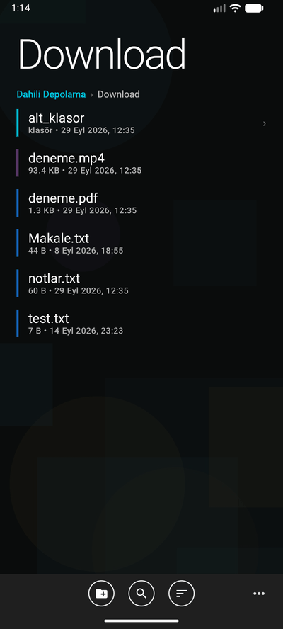

## İnternet, haberler, video

- **Okuma görünümü.** Yazı olan sayfada adres çubuğunun yanında belirir; bir balon haber verir, dokununca sayfa
  sade bir düzene geçer.
- **Okuma listesi** *(Pro)*. Sayfayı ya da bir haberi sonra okumak için kaydet; yazısı telefonda tutulur, bağlantı yokken
  de okunur.
- **Reklam ve izleyici engelleme.** Açık bir engelleme listesiyle; adresin yanındaki kalkan sayfada kaç isteğin
  durduğunu sayar, bozulan bir sitede tek dokunuşla kapanır.
- **Güvenlik.** Adresin başında kilit; sertifikası bozuk bir sayfada boş ekran yerine ne olduğunu anlatan bir uyarı.
- **Basılı tut.** Bağlantıyı yeni ya da gizli sekmede aç, kopyala, paylaş; resmi kaydet ya da kendisini paylaş.
- **Ve dahası.** Site başına yazı boyutu, sayfayı çevir ve PDF olarak kaydet *(Pro)*, çekerek yenile. Başlangıç sayfası bir
  hub: sık ziyaret edilenler, sık kullanılanlar, okuma listesi, geçmiş. Telefonda okurken adres çubuğu ince bir
  şeride iner.
- **Haberler.** Manşetler, gündem, dünya, ekonomi, teknoloji, spor Google Haberler'den; "kaynaklarım" *(Pro)* takip ettiğin
  sitelerin RSS akışlarından, hazır Türkçe, İngilizce, Fransızca, Almanca, İspanyolca, İtalyanca ve Portekizce kaynaklarla ya da kendi eklediğin adreslerle. Habere
  dokununca resmi ve özeti, devamı sitenin kendi sayfasında.
- **Video oynatıcı.** Sade kontroller, iki kez dokunup 10 saniye atla, kaldığı yerden devam, ana ekrana dönünce
  küçük pencerede oynamaya devam. Altyazı (videonun yanındaki dosyalar da), ses parçası, hız, ekranı doldurma,
  klasördeki sonraki bölüm ve yanlışlıkla dokunmaya karşı kilit. Buluttaki videolar indirilmeden akış olarak oynar.

## Varsayılan uygulama

Zeta telefonun varsayılan uygulaması olabilir; bir şey açıldığında karşına yine aynı arayüz çıkar:

- **Ana ekran, telefon, SMS, tarayıcı** — Android'in varsayılan uygulama ayarlarından.
- **Galeri** — galerideki bir fotoğraf albümünün içinde, ekler ve indirilenler fotoğraflar görüntüleyicisinde açılır.
- **Müzik çalar** — bir şarkı müzik + videolar hub'ında, albümüyle birlikte çalar.
- **Video oynatıcı** — telefondaki, buluttaki ve webdeki videolar kendi oynatıcısında.
- **Notlar** — "yeni not" isteği notlar hub'ında boş bir not açar.
- **Uygulama türleri** — "galeriyi aç", "takvimi aç" diyen her şey ilgili hub'a gelir: galeri, müzik, kişiler,
  takvim, mesajlar, e-posta, hesap makinesi, dosyalar, hava durumu, tarayıcı.

## Eylem merkezi

Durum çubuğundan aşağı çekince Android'in paneli yerine eylem merkezi iner: saat,
hızlı eylemler (wi-fi, bluetooth, fener, döndürme kilidi; genişletince mobil veri, uçak modu, konum, sessiz
saatler), ince parlaklık çubuğu, çalan müzik ve uygulamaya göre gruplu bildirimler. Bildirime dokun aç, sağa
kaydır sil, mesajlara yerinde yanıt ver. Başlatıcının kendi bildirimleri e-posta, mesajlar, telefon diye
hub'ına göre ayrılır. Hızlı eylemler panelin içinde düzenlenir: bir kareye basılı tut ya da "düzenle"ye dokun,
sürükleyerek sırala, ✕ ile kaldır, yenilerini ekle (erişim noktası, koyu mod, göz koruma, alarmlar, kamera,
hesap makinesi, notlar ve diğerleri). Panelin saydamlığı ve *(Pro)* arkasının bulanıklığı da orada, değiştikçe
görünerek ayarlanır. Tablette sağ kenardan bir sütun olarak gelir. Bir erişilebilirlik servisiyle çalışır;
kilit ekranında Android'in kendi paneli kalır, böylece bildirimler kilitliyken görünmez.

  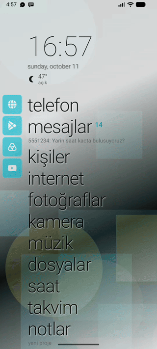
  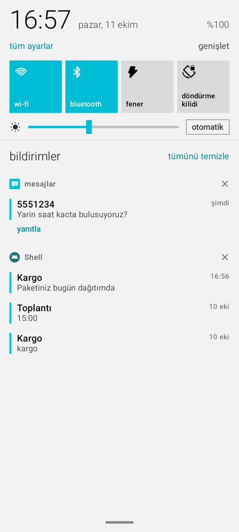

  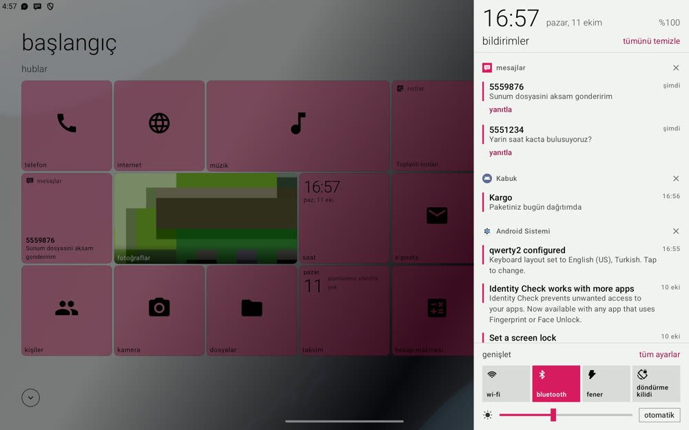

## Tablet

Geniş ekranda başlangıç Panorama'dır: tam ekran, gruplu karolar, yana doğru akan bir pano.
Uygulama listesi onun altında durur — yukarı kaydır ya da sol alttaki oka dokun, karolar ekranın üstünden
çıkarken liste alttan gelir; aşağı kaydır, geri döner. Liste harflere göre gruplu, sütunlar önce aşağı sonra
yana okunur, yana kayar; başlığın yanındaki menü ada, yüklenme tarihine ya da kullanıma göre sıralar. Basılı
tutunca uygulama çubuğu alttan gelir. Panoyu ilk grubun ötesine çekince sosyal hub açılır.
Hub'lar da Panorama düzenindedir: başlıklar solda, açılan şey yanındaki bölmede, komutlar alttaki komut
çubuğunda.

  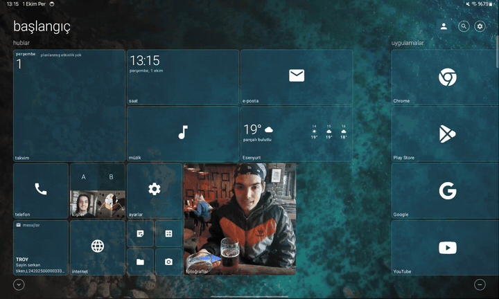

  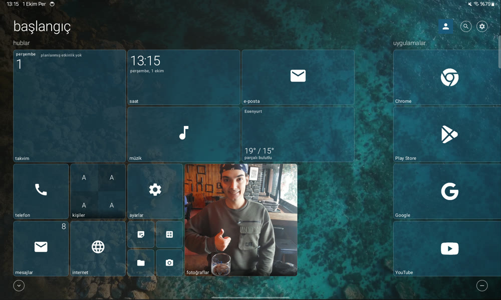
  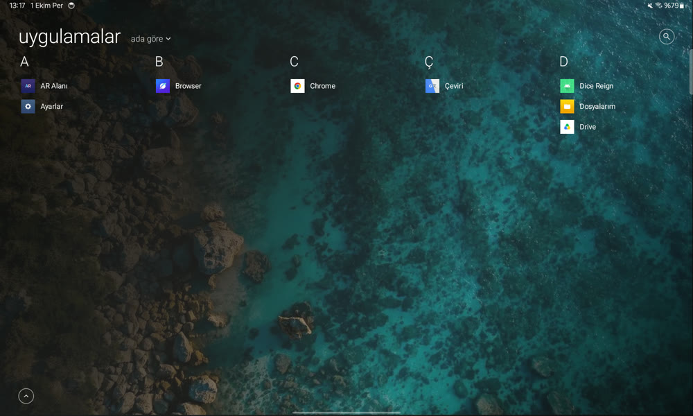

  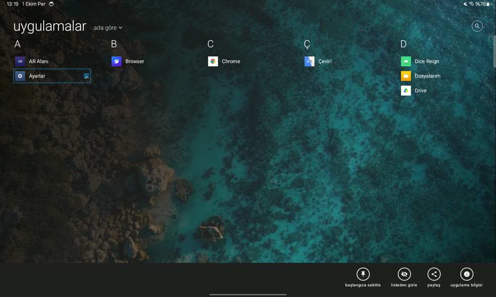
  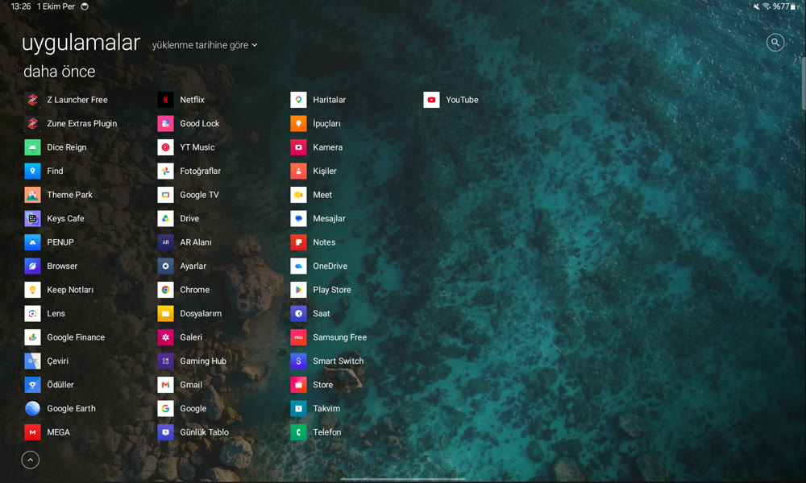

## Televizyon

Android TV ve Google TV'de Zeta kumandayla kullanılır. Televizyonda işe yarayan
hub'lar oradadır: müzik + videolar (oynatıcısıyla), fotoğraflar, hava durumu, haberler, saat, dosyalar ve ayarlar;
telefon, mesajlar, kişiler, kamera gibi telefona özgü olanlar gösterilmez. Ayarlar → görünüm → TV tasarımı'ndan dört
tasarımdan biri seçilir, ana ekran ve bütün hub'lar onunla değişir:

- **Konsol.** Bir oyun konsolu panosu: koyudan açığa inen gri zemin,
  üstte küçük harfli bölümler (ana sayfa, tv + filmler, müzik, uygulamalar, ayarlar), her bölümde yeşil karolardan
  bir grup; kumandanın üstündeki karo büyüyüp aydınlanır, komşu bölümler kenarlarda soluk görünür. Sol altta
  düğmelerin ne yaptığı (Ⓐ seç Ⓑ geri), uygulamalarım sayfası uzun beyaz kartlarla, kapat menüsü beyaz listede yeşil
  seçimle. Hub'lar da aynı dilde: adı sağ üstte, bölümleri altında, komutları sol alttaki düğme açıklamalarında.
  Ana sayfada sabitlenenler ve son kullanılanlar karoları; büyük karo yarıda kalan filmi, çalan albümü, son
  fotoğrafı, hava durumunu ve manşeti sırayla gösterir; alttaki karolar son açtığın iki şeydir. Bir karoya ya da
  uygulamaya basılı tutunca ayrıntı sayfası açılır: aç, ana sayfaya sabitle, öne taşı, uygulama bilgisi, kaldır;
  yarıda kalan filmde devam et ya da baştan başla. Kumandanın menü tuşu (ya da Home'a uzun basış) rehberi
  açar: son kullanılanlar, çalan müziği duraklatma ve geçme, hub'lar, uyku ve kapatma. Ana sayfanın sol kenarında
  arama durur: televizyonun uygulamaları, hub'lar ve televizyondaki şarkılar, albümler, videolar. Kart sayfalarının
  üstünde "göster" ve "sırala" seçicileri (ada, yüklenme tarihine, son kullanıma göre). Gamepad'in Ⓧ'i ya da
  kumandanın mavi tuşu ayrıntıları, Ⓨ ya da sarı tuş sabitlemeyi açar. Sabitleme, yeni yüklenen ve güncellenen
  uygulamalar alttan çıkan bir bildirimle haber verilir. Sağ üstte profil: televizyonun adı ve eşlenen
  telefon. Ayarlar bölümündeki "sistem ayarları" konsolun beyaz listesi gibi: tema (gri, gece mavisi, mor, turuncu,
  siyah ya da televizyondaki bir resim), ekran koruyucu (karartma ya da resimler, 5–30 dakika), görselleştirici,
  uyku zamanlayıcısı ve televizyonun görüntü, ses, ağ, kumanda, tarih, depolama ayarlarına kısayollar. Müzik
  çalarken kumandaya iki dakika dokunulmazsa şarkı ekranı doldurur: kapağı, adı, ilerlemesi ve arkada kayan dev
  sanatçı adı; rehberden de açılır.
- **Salon** *(Pro)*. Oturma odası için bir medya arayüzü: solda soluk "başlat" yazısı,
  alt alta dönen kategoriler (Resimler + Videolar, Müzik, TV + Filmler, Uygulamalar, Bilgiler, Görevler), yerinden
  oynamayan cam bir kutu ve içinden kayan öğeler; program kitaplığı ve kapat penceresi. Kitaplıklarda ad sağ üstte
  büyük ve soluk, komutlar sol üstte bağlantı, seçili yol ‹ › arasında.
- **Aura.** Telefondaki Aura, televizyonda: Aura ışıltısının üstünde solda dev ve ince harflerle hub'ların
  adları, üstlerinde saat; yanda son kullanılanlar, televizyonun uygulamaları ve kaynakları resimleriyle. Hub'lar
  tabletteki gibi: adı solda dikine dev harflerle, bölümleri yanında. Senin vurgu rengin, telefondaki ışıltı
  biçimleri ve renkleri; kapat menüsünde TV'yi kapatma, uyku, uyku zamanlayıcısı ve çıkış.
- **Vitrin** *(Pro)*. Açık, çizgili bir zeminde kanallar gibi dizilmiş kareler: sayfada dört sütun üç sıra, kenarda
  bir sonraki sayfanın ilk sütunu. Her kanal içindekini canlı gösterir: yarıda kalan film, çalan şarkı, son
  fotoğraf, hava, manşet, ibreleri dönen saat, uygulamaların afişleri. Seçilen kanal yerinden ekranı kaplayana
  dek büyür ve hareketli büyük afişini oynatır; altta "Vitrin" ve "Başlat" düğmeleri çıkar, yanlara basınca komşu
  kanallara geçilir (önizleme ayarlardan kapatılabilir). Ortadaki tuşa basılı tutunca kanal kaldırılıp başka bir
  yere taşınır. Alttaki çubuğun ortasında saat ve tarih, solda Vitrin menüsü (ayarlar, uyku, kapatma), sağda
  telefondan gelen aramaların ve mesajların günlere göre zarf zarf durduğu mesaj panosu. Hub'lar beyaz bir başlık
  şeridinin altında, bölümleri yuvarlak düğmeler: ayarlar büyük beyaz düğmeler, haberlerde altta kayan manşet
  şeridi, fotoğraflar beyaz kenarlı baskılar gibi, video oynatıcısında beyaz yuvarlak düğmeler; açık lisanslı
  Nunito yazı tipi ve bu projede üretilen sesler.

Konsol ile Salon'da açılışta logo, sayfalar arasında yakınlaşma, açık lisanslı Selawik yazı tipi ve kapatılabilir gezinme
sesleri var; logolar ve sesler bu projede çizildi ve üretildi. Yarıda bırakılan film
"devam et"te, televizyonun uygulamaları kendi afişleriyle durur. Kumandanın Home tuşu, erişilebilirlik servisi
açıksa Google TV'nin ana ekranı yerine Zeta'yı açar; televizyon açılınca ya da uykudan ana ekranında uyanınca da
Zeta gelir.

**Telefon bağlantısı.** Telefonunda Zeta kullanıyorsan onu aynı Wi-Fi'daki televizyonla eşleyebilirsin
(televizyonda ayarlar → bağlantılar → telefon ekle, telefonda TV ekle, 6 haneli kod). Sonra telefona gelen
aramalar, cevapsız aramalar ve mesajlar televizyonun köşesinde, açık olan her şeyin üstünde görünür. Mesajın
metni varsayılan olarak gitmez; telefonda açılabilir. Sunucu yoktur, her şey ev ağında ve şifreli gider.
Eşlenen telefon televizyonun kumandası da olur (yön tuşları, OK, geri, ana ekran, ses; yazdığın, televizyonda
seçili arama kutusuna gelir), paylaş menüsündeki "TV'de aç" bir bağlantıyı (YouTube bağlantısı YouTube'da)
ya da bir fotoğrafı televizyonda açar.

**Televizyonda ayrıca:** arama kutularında yukarı tuşu televizyonun sesli aramasını açar; kaynaklar (HDMI, anten)
karo olarak durur; rehberde uyku zamanlayıcısı ve hızlı ayarlar var; çocuk kilidi seçilen uygulamaları, kaynakları
ve ayarları 4 haneli bir PIN'in arkasına koyar; istenmeyen uygulamalar başlangıç ekranından gizlenebilir.

  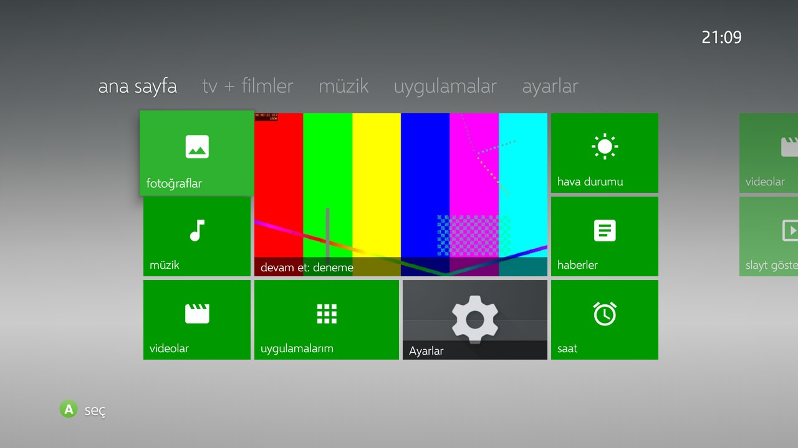
  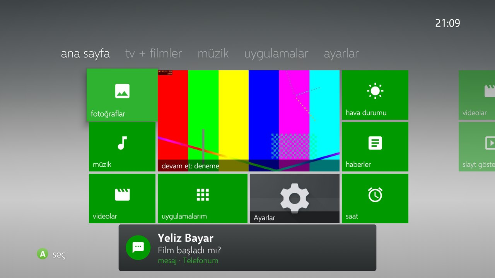

  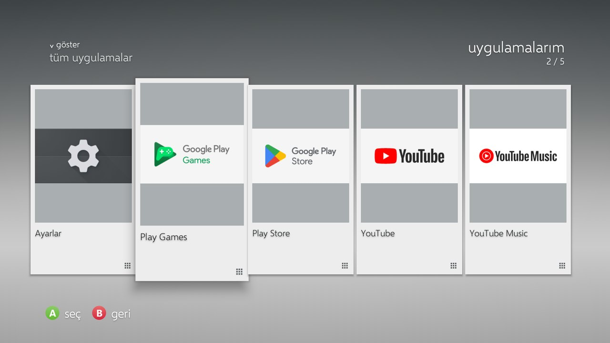
  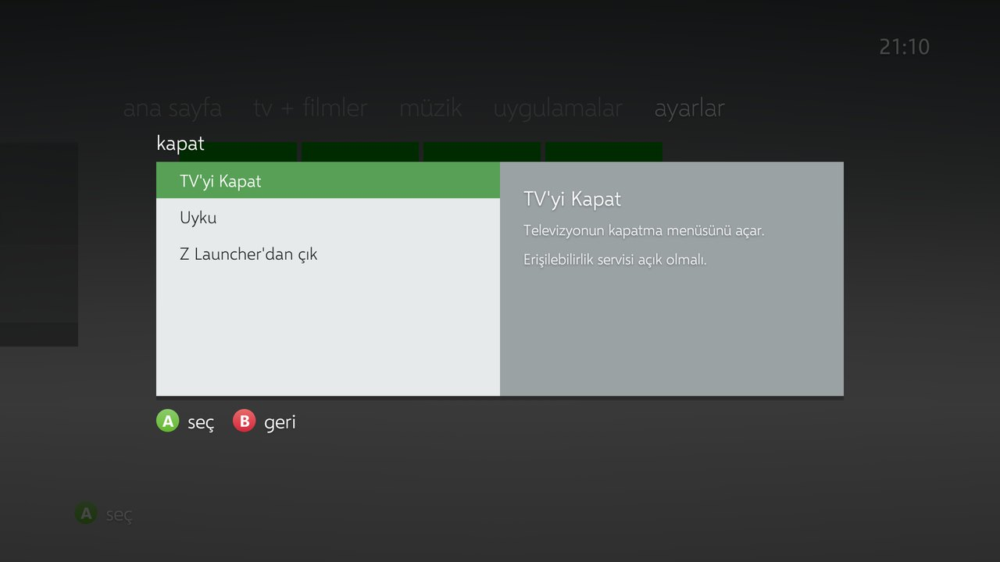

  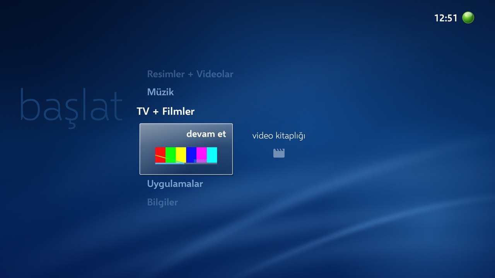
  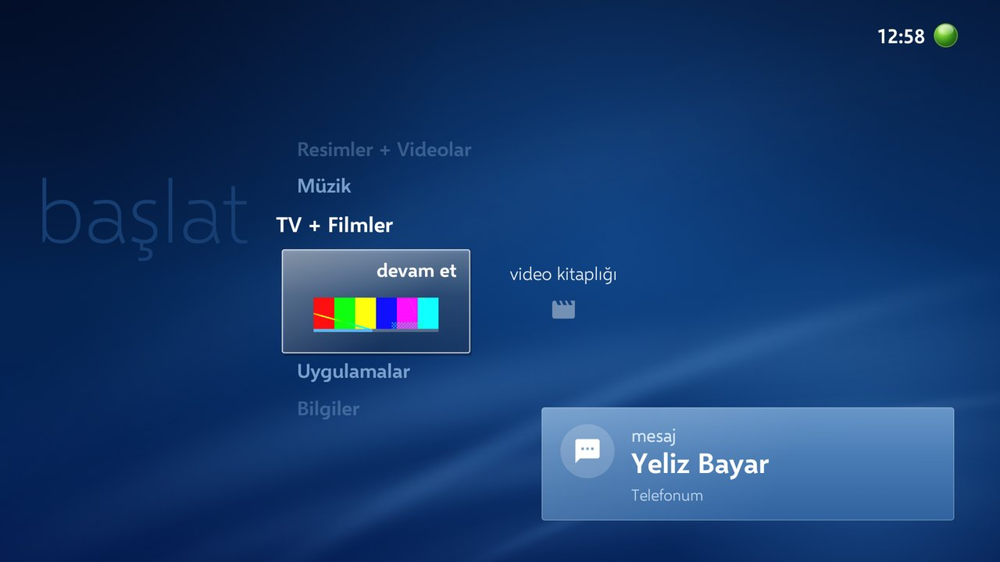

  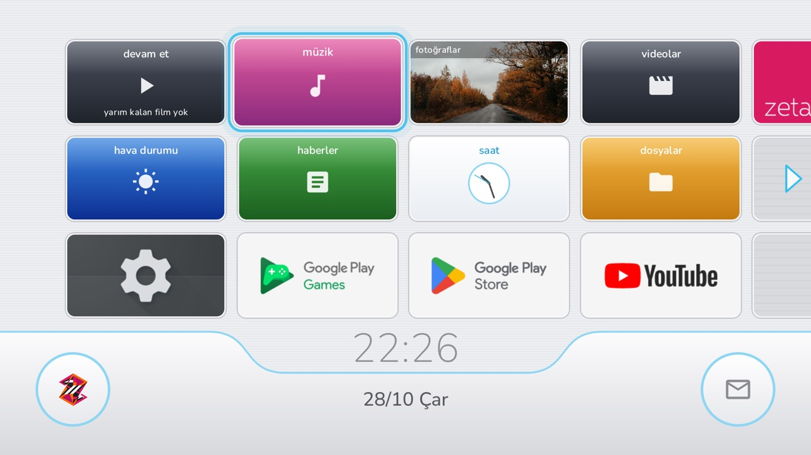

  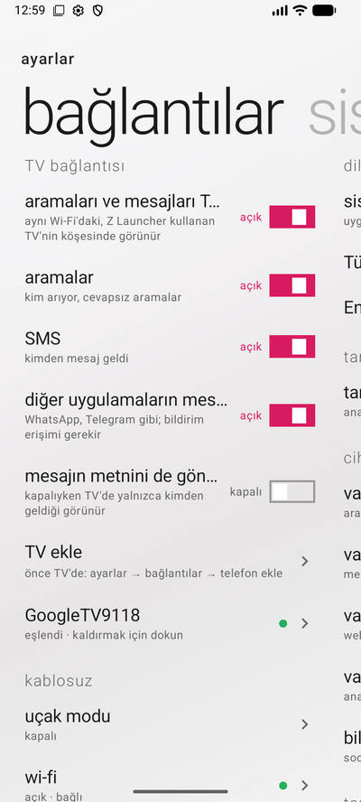

## Ayarlar

Mozaik'in ayarlar dili: pivot başlıklar, ince kaydırıcılar, köşeli anahtarlar.

- **ekran+ses** — telefonun kendi ayarları: otomatik parlaklık, ekran kapanma süresi, otomatik döndürme; zil,
  titreşim, sessiz; medya, zil, bildirim ve alarm sesleri; zil, bildirim ve alarm tonu; dokunma sesleri ve
  titreşimi.
- **bağlantılar** — uçak modu, Wi-Fi, Bluetooth, mobil veri, veri dolaşımı, veri kullanımı, internet paylaşımı,
  konum, NFC, VPN, ekran yansıtma; her biri o anki durumuyla, dokununca Android'in kendi anahtarı açılır
  (Android bunları hiçbir uygulamanın kendisi açıp kapatmasına izin vermiyor).
- **hakkında** — sürüm notları ve bu cihazın bilgileri: model, Android sürümü, güvenlik güncellemesi, işlemci,
  bellek, depolama, ekran.

## Ayrıca

- Zeta klavyesi ve tahmin çubuğu *(Pro)*
- Ses çubuğundan bildirim şeridine kadar aynı arayüz *(Pro)*
- Türkçe, İngilizce, Fransızca, Almanca, İspanyolca, İtalyanca ve Brezilya Portekizcesi (klavye de: Fransızca AZERTY, Almanca QWERTZ, İspanyolca ñ, Portekizce ç ile)
- Bölünmüş ekran: tablette dört, telefonda iki parmakla

## Ücretsiz ve Pro

> **Beta boyunca Pro ücretsiz.** Zeta beta aşamasındayken GitHub'dan indirilen sürümde tüm Pro
> özellikleri açıktır; deneme sorulmaz, bir şey satılmaz. Zeta Google Play'e çıkınca Pro tek seferlik
> bir satın alma olacak. Beta'da yaptığın Pro ayarları silinmez, olduğu gibi kalır.

Başlangıç ekranı (pil, fener, zamanlayıcı, ses modu ve arama widget'ları dahil), bütün hub'lar, eylem merkezi, tablet düzeni, televizyon arayüzü (Konsol ve Aura tasarımları ile
telefon bağlantısı dahil) ve varsayılan uygulama rolleri ücretsiz sürümde tamdır. **Pro, uygulamanın içinden tek seferlik bir satın almayla açılır** (Google Play üzerinden;
ayarlar → hakkında → Zeta Pro, ya da kilitli herhangi bir şeye dokunarak). Bir kez alınır, aynı Google
hesabıyla her telefonda geçerlidir; ayarların yerinde kalır. Pro şunları ekler:

- **Görünüm:** vurgu renklerinin tamamı, özel duvar kağıdı, buzlu karolar ve buzlu eylem merkezi, karo başına renk, ad, simge,
  resim, animasyon, saydamlık ve yazı rengi, hub arka planı ayarları
- **Medya:** video oynatıcıda altyazı, ses parçası, hız, ekranı doldurma, sonraki bölüm ve küçük pencere;
  internetten şarkı sözü ve albüm kapağı
- **Hub'lar:** sosyal hub, kilitli notlar, haberlerde kendi RSS kaynakların, tarayıcıda okuma listesine
  ekleme, PDF olarak kaydetme, çeviri ve sık kullanılanlar; başlangıca 10'dan fazla uygulama, birden çok
  hava durumu şehri
- **Widget'lar:** dünya saati, geri sayım, yapılacaklar ve adım sayar
- **Televizyon:** Salon ve Vitrin tasarımları
- **Sistem:** Zeta klavyesi, ses çubuğu ve bildirim şeridi

**Pro, 10 gün ücretsiz denenebilir.** Uygulama bunu bir kez sorar; istemezsen ayarlar → hakkında → Zeta
Pro'dan istediğin zaman başlatırsın. Deneme bitince Pro'ya ait özellikler kapanır, deneme sırasında
yaptığın Pro ayarları ise silinmez, Pro'yu alınca olduğu gibi geri gelir. Deneme bir kez alınır;
uygulamanın verisi temizlense de yeniden başlamaz.
Satın alma yalnızca Google Play'den kurulan uygulamada yapılabilir.
Ücretsiz sürüm hiçbir verini Pro'ya kilitlemez: kilitli bir not yine açılır, okuma listesindekiler yine
okunur, Pro ayarları silinmez, Pro'ya geçince olduğu gibi geri gelir.

## Gizlilik

Sunucu yok. Uygulamada reklam, analiz, kullanıcı hesabı yok. Kişilerin, mesajların ve fotoğrafların telefonda kalır.
Telefondan yalnızca hava durumu, haberler, şarkı sözü ve arama önerisi istekleri çıkar (tarayıcıda reklam
engelleme açıksa haftada bir engelleme listesi de indirilir) — o da o özelliği kullandığında ve kimliğin eklenmeden. E-posta şifreleri ve kilitli notlar cihazda şifrelenir.
Üç izin isteğe bağlıdır ve tek bir iş içindir: hassas konum yalnızca bağlı Wi-Fi ağının adını göstermek için
(hava durumu yuvarlanmış, yaklaşık konumu kullanır), yakındaki cihazlar yalnızca bağlı Bluetooth cihazlarının
adları ve pil widget'ındaki pil düzeyleri için, fiziksel etkinlik yalnızca adım widget'ının bugünkü adımları sayması için (sayı telefonda kalır).
Telefon bağlantısı açıksa aramalar ve mesajlar yalnızca eşlediğin televizyona, ev ağının içinden ve şifreli
gider; mesaj metni sen açmadıkça gitmez.
Ayrıntılar: [PRIVACY.md](PRIVACY.md) · [English](PRIVACY.en.md) · [web](https://serkantkn.github.io/Zeta/gizlilik.html).

## Geliştiriciler: Zeta için hub yaz

Başka uygulamalar da Zeta'ya hub ekleyebilir. Uygulaman hub'ı **ZetaHubKit** ile tarif eder (sayfalar, listeler,
düğmeler, alt çubuk, canlı karo); Zeta onu telefonda, tablette, Aura'da ve Mozaik'te kendi hub'larından ayırt
edilmeyecek şekilde çizer. Kod Zeta'ya girmez, kullanıcı onaylamadan hub eklenmez, Zeta hub'a hiçbir veri
vermez. ZetaHubKit Apache 2.0 lisanslıdır ve [herkese açık depoda, `hubkit/` klasöründedir](https://github.com/serkantkn/Zeta/tree/main/hubkit);
örnek bir hub [`hubkit/sample`](https://github.com/serkantkn/Zeta/tree/main/hubkit/sample)'da. Rehber:
[Zeta için hub yaz](https://serkantkn.github.io/Zeta/gelistiriciler.html).

## İndirme, geri bildirim ve lisans

Zeta'nın sürümleri bu depodan yayımlanır: [Releases](https://github.com/serkantkn/Zeta/releases). APK'yı
indirip kurman yeterli; Android 9 ve üstü, telefon, tablet ve Android TV / Google TV'de aynı dosya.
Hata ve öneriler için [issue aç](https://github.com/serkantkn/Zeta/issues).

Zeta kapalı kaynaktır: uygulamayı ücretsiz kullanabilirsin, kaynak kodu yayımlanmaz. Bu depodaki
[`hubkit/`](hubkit/) klasörü (ZetaHubKit, başka uygulamaların Zeta'ya hub eklemesi için) bunun dışındadır:
Apache Lisansı 2.0 ile açıktır.

## Teşekkür

Klavyenin kelime listeleri Hermit Dave'in [FrequencyWords](https://github.com/hermitdave/FrequencyWords)
verisinden (CC BY-SA 4.0) uyarlanmıştır ve aynı lisansla paylaşılır; kelime çiftleri ve büyük harf bilgisi
[Tatoeba](https://tatoeba.org) cümlelerinden (CC BY 2.0 FR) sayılmıştır. Önerilmeyen kaba kelimeler [LDNOOBW](https://github.com/LDNOOBW/List-of-Dirty-Naughty-Obscene-and-Otherwise-Bad-Words) listesinden (CC BY 4.0) seçilmiştir. Ayrıntılar
uygulamanın ayarlar › hakkında sayfasında.

Karo glifleri Microsoft'un [Fluent UI System Icons](https://github.com/microsoft/fluentui-system-icons) setinden
(MIT).

---

## English

**Live tiles, again.** An interface suite for phone, tablet and television, written from scratch: live tiles,
hubs, turnstile animations and thin, big type, running on today's Android — and sending nothing anywhere.
Start, messages, music and the TV all speak one language, and the phone link lets the devices know of each other.

- **Start screen.** Small, medium, wide and large tiles; live tiles that turn by themselves; folders; pin apps,
  people, conversations, albums, records, notes and web pages. Every live tile is laid out for every size, its
  count right beside its icon, and the wallpaper behind see-through tiles can be frosted. Every tile can be given its own colour, name,
  icon, picture, animation, transparency and ink, and reset with one tap. Any hub's tile can open another
  app instead. Three layouts: Mosaic (live tiles), Aura (a list of hubs as huge words), and Panorama on tablets.
- **The Aura layout.** A list of hubs as words, each with a live line beneath it. In phone,
  people, messaging, music, videos and pictures the name touched flies up and becomes the hub's huge, bold title,
  which runs off the right edge, slides as the pages turn and goes back when touched; a conversation, a contact,
  a group, an album or a music list opens and closes the same way. Music has its own menu with genres and an
  alphabet jump, quickplay sits in the list (always open on the right on a tablet), and pinned apps stand as
  Mosaic tiles on a page of their own.
- **Tablet.** Panorama's Start, full screen and grouped; a swipe up slides it off while the app list rises from
  below — apps under their letters in columns, scrolling sideways, ordered by name, install date or use, with
  the app bar on a hold. Pulling the board past its first group opens the social hub.
- **Television.** On Android TV and Google TV the launcher is worked with the remote, with the hubs that make
  sense on a TV: music + videos with the player, pictures, weather, news, clock, files and settings. Four designs,
  chosen in settings → look → TV design, Start and every hub with them: **Console**, a games
  console's dashboard - a grey ground, lower-case sections along the top, blocks of
  green tiles, the one the remote is on lifted, the neighbours peeking in at the edges, the button legend at the
  bottom left - or **Lounge** *(Pro)*, a living-room media interface, its categories turning through a fixed pane of glass in one of seven colours - or **Aura**, the phone's own:
  the hubs as huge light words on Aura's glow, the things opened lately, the TV's apps and inputs beside them, each hub's
  name huge and turned on its side, in the user's accent colour - or **Showcase** *(Pro)*, a board of channels on a pale lined ground, each showing what it holds,
  opening into a large moving preview before it starts, the clock in the bar along the foot and a message board for
  the phone's calls and messages, in the open Nunito type. Console and Lounge
  have a logo at launch, a zoom between pages, the open Selawik type and navigation sounds made here
  that can be turned off. A film left part way waits under "continue"; the remote's Home button opens Zeta
  through an accessibility service, and Zeta comes up when the TV is turned on or wakes on its home screen. **The phone link** pairs a phone running Zeta with a TV on the same
  Wi-Fi by a six-digit code; calls, missed calls and messages then show in the TV's corner over whatever is
  on. The message text stays on the phone unless you allow it; no server, encrypted, on your own network.
  The paired phone is also the TV's remote (arrows, OK, back, home, volume, and typing into the TV's search box),
  and "Open on TV" in the share sheet opens a link (a YouTube link in YouTube) or a picture on the TV. On the TV,
  up from a search box searches by voice; inputs (HDMI, aerial) are tiles; the guide has a sleep timer and quick
  settings; a child lock keeps chosen apps, inputs and the settings behind a four-digit PIN; unwanted apps can be
  hidden from Start.
- **Action center.** A pull from the status bar brings down the action center instead of
  Android's shade: quick actions, a thin brightness slider, the music playing, and notifications grouped by
  app — the launcher's own by hub — to open, swipe away or answer in place. On a tablet it is a column from
  the right edge. It runs on an accessibility service, and the lock screen keeps Android's own shade.
- **Hubs, all in-app.** Phone, Messaging (picture messages, search in a conversation, delivery reports),
  People (a panorama: all, what's new, recent), Pictures, Music + Videos (with the launcher's
  own video player: small window, resume where you left off, subtitles, sound tracks, speed, the next
  episode, a touch lock), Internet, News, Email, Notes, Files (folders as tiles; copy, cut, paste, rename,
  delete, details, drag up a folder; opens text, pictures, sound, video and PDF itself; cloud files through the phone's own picker), Social,
  Clock, Calendar, Weather, Calculator, Camera. Hubs left with Home keep running and come back from the
  running-hubs strip, a double press of Home, or a two-finger swipe that splits the screen. On a tablet a hub
  has its headings down the left, what is open in a pane beside them, and a command bar.
- **Internet and news.** Reading view offered beside the address where a page suits it, a reading list kept
  for offline, ad and tracker blocking with a per-site switch, a padlock and a proper warning for a bad
  certificate, a menu for held links and pictures, text size by site, translate, save as PDF, pull to reload.
  The news hub gathers Google News topics and the RSS feeds of the sites you follow; a story opens to its
  summary, and the rest is read on its own site.
- **Default apps.** Besides Home, phone, SMS and browser, the launcher can be the phone's gallery, music
  player, video player and notes app, and answers when Android asks for the gallery, music, contacts,
  calendar, messaging, email, calculator, files, weather or browser app.
- **Settings.** Mosaic's sliders and switches. Display+sound holds the phone's own brightness, screen
  timeout, rotation, ringer, volumes, tones and touch sounds; connections shows airplane mode, Wi-Fi,
  Bluetooth, mobile data, roaming, data usage, hotspot, location, NFC, VPN and casting as they are and opens
  Android's own switch for each; about lists this device.
- **Looks.** By default the accent follows the design (Mosaic blue, Aura orange, Panorama red, Console green), Aura on its magenta-to-orange glow, with solid tiles 5 dp apart; fourteen accent colours and a custom one, dark and light themes, tile transparency and frost,
  corner style and spacing. Zeta's own keyboard *(Pro)*.
- **Pro is free during the beta.** While Zeta is in beta every Pro feature is on in the build from GitHub: no trial
  is asked for and nothing is for sale. Once Zeta is on Google Play, Pro will be a one-time purchase; what you
  set up in the beta stays as it is.
- **Languages.** Turkish, English, French, German, Spanish, Italian and Brazilian Portuguese, the keyboard with
  each one's own word suggestions. With the battery saver on, the blur and the animations rest by themselves.
- **Free and Pro.** Start, every hub, the action center, the tablet layout, the TV interface (the Console and Aura designs
  and the phone link) and the default-app roles are whole in the free edition. Pro is one purchase inside the app, through Google Play (settings → about → Zeta
  Pro, or touch anything locked); bought once, it holds on every phone signed in to the same Google account.
  Pro adds all accent colours, custom wallpaper, frosted tiles, each tile's own look,
  the hubs' background settings, the video player's subtitles, sound tracks, speed, fill, next episode and
  small window, online lyrics and covers, the social hub, locked notes, the news hub's own RSS sources, the
  browser's reading list, PDF, translation and favourites, the TV's Lounge and Showcase designs, Zeta's keyboard, volume bar and banners.
  Pro can be tried free for 10 days: the app asks once, and settings → about → Zeta Pro starts it later.
  When it ends, Pro's features close, and what was set in Pro waits, untouched, for Pro to be bought. The
  trial is taken once; clearing the app's data does not start it again.
  Nothing of yours is locked away: a locked note still opens, saved pages still read, and Pro's settings
  wait, untouched, for Pro.
- **For developers.** Other apps can add hubs to Zeta: an app describes its hub with **ZetaHubKit** (pages, lists,
  buttons, the bar, a live tile) and Zeta draws it on phones and tablets, in Aura and in Mosaic, like one of its own.
  No code goes into Zeta, no hub is added without the person's say, and Zeta gives a hub none of their data.
  ZetaHubKit is Apache 2.0, in the public repository's [`hubkit/`](https://github.com/serkantkn/Zeta/tree/main/hubkit); guide: [write a hub for Zeta](https://serkantkn.github.io/Zeta/developers.html).
- **Privacy.** No server, and in the app no ads, no analytics, no account. Only weather, news, lyrics and search suggestions
  (and, with blocking on, a weekly blocklist download) ever leave the phone, and only when you use them. Two
  optional permissions do one thing each: precise location only shows the Wi-Fi network's name (the weather
  keeps to a rounded, approximate position), nearby devices only names the Bluetooth devices connected. See [PRIVACY.en.md](PRIVACY.en.md).

**Download** the APK from [Releases](https://github.com/serkantkn/Zeta/releases) (Android 9 or later; the
same file runs on phones, tablets and Android TV / Google TV) and report bugs or ideas in
[issues](https://github.com/serkantkn/Zeta/issues). Written in Kotlin, all of the UI in Jetpack Compose.
**Zeta is closed source** and free to use; only [`hubkit/`](hubkit/) (ZetaHubKit) is open, under the Apache License 2.0. Tile glyphs are Microsoft's Fluent UI System Icons (MIT); the TV designs use the Selawik and Nunito typefaces (SIL OFL 1.1). The keyboard's word lists are adapted from FrequencyWords (CC BY-SA 4.0) and Tatoeba (CC BY 2.0 FR). The offensive-word filter draws on LDNOOBW (CC BY 4.0).
